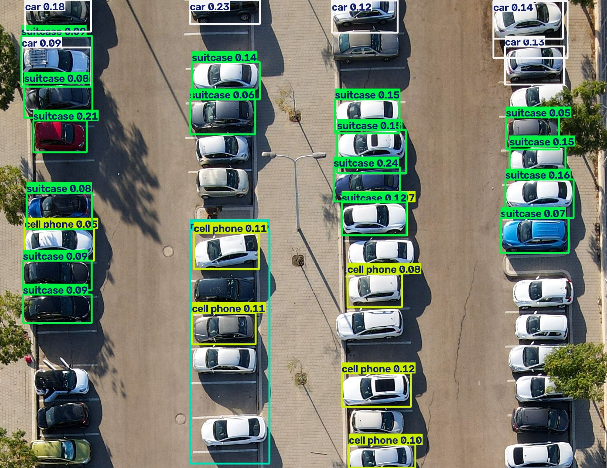
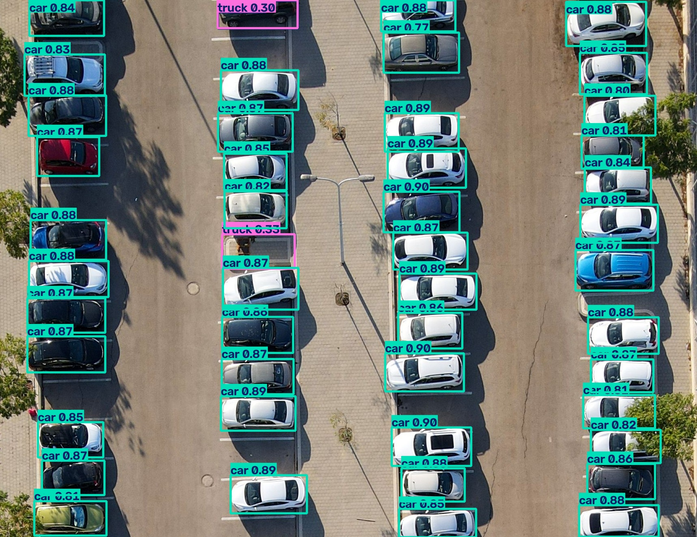
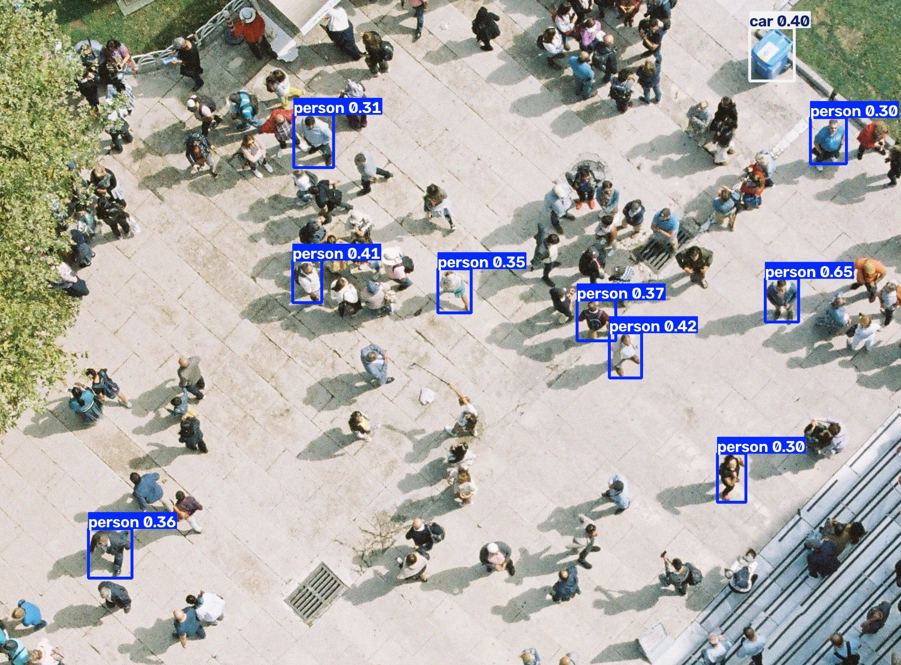
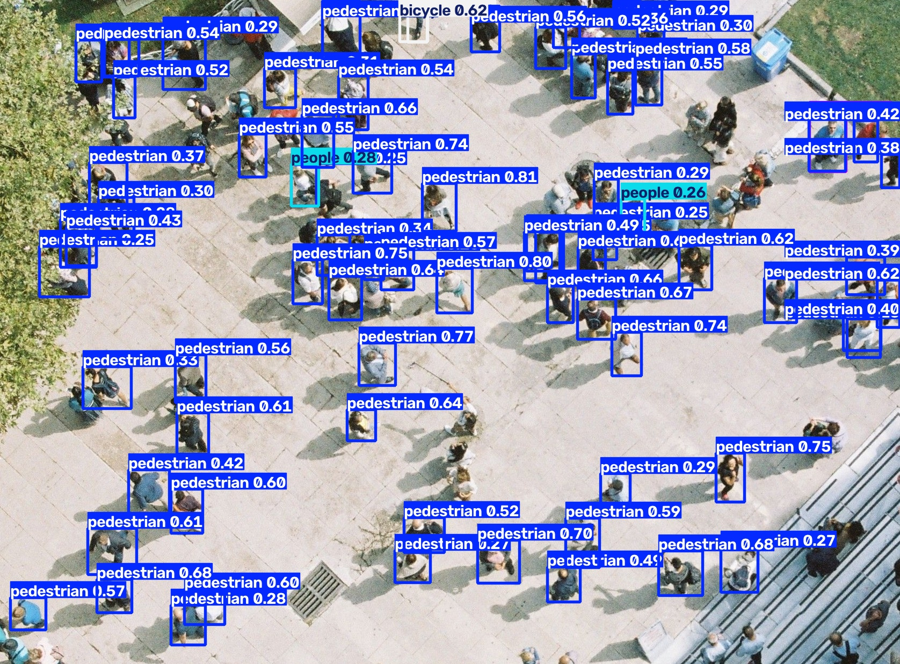

<div align="center">

# 🛰️ VisDrone Nano Detector

**A lightweight YOLO11n model fine-tuned for small-object detection in drone-view imagery.**


[Before vs After](#-before-vs-after) · [Results](#-results) · [Quick Start](#-quick-start) · [Training](#-training-details) · [Limitations](#-limitations) · [Roadmap](#-roadmap)

</div>

---

## 📌 Overview

Standard object detectors are trained mostly on ground-level photos. Seen from above, a car is a roof and a person is a small blob, so those detectors often fail on drone footage.

This project fine-tunes the smallest YOLO11 model (**nano**, about 2.6M parameters) on the public **VisDrone** dataset so it can recognize people and vehicles from an aerial view, while staying small enough to target low-cost edge hardware.

> **Status:** early experiment by a 2nd-year engineering student. Open-sourced so others can reproduce, critique and improve it. Not production-ready.

## ✨ Highlights

- 🪶 **Tiny:** the trained weights are only about 5.5 MB.
- 🎯 **Drone-view aware:** detects 10 classes, including pedestrians, cars, buses and motorbikes.
- 🔁 **Reproducible:** every setting used is listed below, and training runs on a free Colab T4 GPU.
- 📓 **Honest reporting:** results, failures and limits are all documented.

## 🔍 Before vs After

The same two photos, run through the stock COCO-pretrained YOLO11n (**before**) and through this fine-tuned model (**after**). Images show cropped regions of the original photos.

### Top-down parking lot

| Stock YOLO11n (before) | Fine-tuned (after) |
|:---:|:---:|
|  |  |
| Finds only a few cars, all at very low confidence, and mislabels others as objects like *suitcase* and *cell phone*. | Boxes nearly every car, mostly at 0.8 to 0.9 confidence. Two likely false *truck* boxes appear on non-vehicle objects. |

### Crowd seen from a high vantage point

| Stock YOLO11n (before) | Fine-tuned (after) |
|:---:|:---:|
|  |  |
| Detects only a handful of people and labels a blue bin as a *car*. Most of the crowd is missed. | Detects many more people, but also produces overlapping boxes, probably some false detections, and still misses people in dense groups. |

**About these examples:** they are qualitative demonstrations on two photos, not a benchmark. The confidence thresholds were not identical across all four runs (the stock model's weak guesses are shown so they are visible), the crowd photo is an elevated oblique view rather than true drone footage, and the confidence labels are drawn on the images. For measured accuracy, see the results below.

## 📊 Results

Evaluated on the VisDrone2019-DET **validation split** (548 images, 38,759 labelled objects) at 960 px.

### Overall

| Metric | Value |
|---|---|
| mAP50 | **0.388** |
| mAP50-95 | 0.225 |
| Precision | 0.514 |
| Recall | 0.380 |
| Inference time | about 4.0 ms/image on a Tesla T4 (validation run) |

### Per class

| Class | Precision | Recall | mAP50 | mAP50-95 |
|---|---|---|---|---|
| Car | 0.691 | 0.790 | **0.797** | 0.545 |
| Bus | 0.719 | 0.458 | 0.500 | 0.361 |
| Motor | 0.545 | 0.451 | 0.453 | 0.192 |
| Pedestrian | 0.545 | 0.425 | 0.442 | 0.198 |
| Van | 0.550 | 0.398 | 0.431 | 0.295 |
| Truck | 0.524 | 0.348 | 0.359 | 0.242 |
| People | 0.536 | 0.310 | 0.335 | 0.122 |
| Tricycle | 0.436 | 0.278 | 0.256 | 0.140 |
| Awning-tricycle | 0.320 | 0.158 | 0.157 | 0.097 |
| Bicycle | 0.270 | 0.180 | 0.144 | 0.061 |

Large, common objects (cars) are detected well. Small and rare objects (bicycles, awning-tricycles) are still weak.

### Experiment log

| Run | Image size | Epochs | mAP50 | Pedestrian | People | Car |
|---|---|---|---|---|---|---|
| v1 | 640 | 10 | 0.256 | 0.267 | 0.191 | 0.686 |
| **v2 (this release)** | **960** | **20** | **0.388** | **0.442** | **0.335** | **0.797** |

Image size and epoch count were changed together, so the gain cannot be attributed to either one alone.

## 🚀 Quick Start

```bash
pip install ultralytics
```

```bash
yolo predict model=best.pt source=your_image.jpg imgsz=960 conf=0.25
```

Or in Python:

```python
from ultralytics import YOLO

model = YOLO("best.pt")
results = model.predict("your_image.jpg", imgsz=960, conf=0.25)
results[0].show()
```

**Tip:** use `imgsz=960` to match training. Lowering `conf` finds more objects but adds false alarms; raising it does the opposite.

## 🧪 Training Details

| Setting | Value |
|---|---|
| Base model | YOLO11n (Ultralytics), COCO-pretrained |
| Dataset | VisDrone2019-DET (6,471 train / 548 val images) |
| Epochs | 20 |
| Image size | 960 |
| Batch size | 8 |
| Optimizer | AdamW (auto-selected by Ultralytics) |
| Hardware | Google Colab, Tesla T4 |
| Training time | about 1.3 hours |
| Library version | Ultralytics 8.4.215 |

To reproduce:

```bash
yolo detect train model=yolo11n.pt data=VisDrone.yaml epochs=20 imgsz=960 batch=8
```

## ⚠️ Limitations

Please read these before relying on the model:

- **VisDrone only.** Not tested on other cameras, altitudes, countries, night footage or thermal imagery.
- **Weak on small, rare classes** such as bicycles and awning-tricycles.
- **Recall is 0.38.** The model still misses many labelled objects, especially in dense crowds.
- **False and duplicate detections.** Overlapping boxes and occasional wrong labels appear, particularly at lower confidence thresholds.
- **Edge speed not yet measured.** The speed figure above is from a desktop-class GPU, not a Raspberry Pi or similar device.
- **Not safety-critical.** Do not use this model where missed or false detections could cause harm.

## 🗺️ Roadmap

- [x] Fine-tune YOLO11n on VisDrone
- [x] Compare image sizes and training lengths
- [ ] Measure speed on CPU / Raspberry Pi (ONNX export)
- [ ] Try a P2 small-object detection head
- [ ] Try tiled inference for tiny objects
- [ ] Evaluate on VisDrone test-dev and on harder, self-collected images
- [ ] Publish a Colab demo notebook

Contributions, bug reports and suggestions are welcome through GitHub Issues.

## 📜 License and Credits

- This repository's code and weights are released under **AGPL-3.0**, consistent with Ultralytics YOLO.
- Built with [Ultralytics YOLO](https://github.com/ultralytics/ultralytics) (AGPL-3.0).
- Trained on the [VisDrone](https://github.com/VisDrone/VisDrone-Dataset) dataset from the AISKYEYE team at Tianjin University. Please read the dataset's own terms before any commercial use.

If you use the VisDrone dataset, please cite its authors (see the VisDrone repository for the current citation).

### Image credits

Example photos in the "Before vs After" section:

- Parking lot photo: *photographer name, source site and link*
- Crowd photo: *photographer name, source site and link*

## 👤 Author

**Mohit Choudhary**, 2nd-year engineering student
🔗 [LinkedIn](https://www.linkedin.com/in/mohit-choudhary-018-) · 💻 [GitHub](https://github.com/mohittchoudhary)

Feedback, especially from people who work with drone footage, is very welcome.

---

<div align="center">

⭐ If this project is useful or interesting to you, consider giving it a star.

</div>
